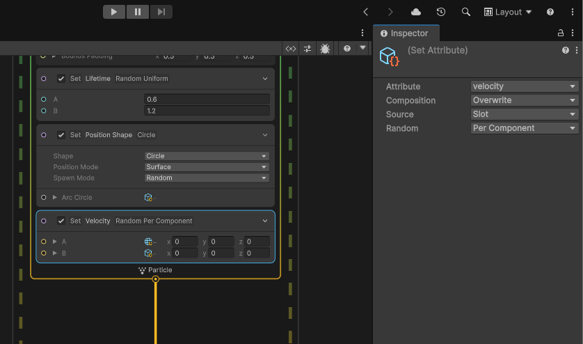

# Using Physics – Cannonball Splash VFX

This guide builds the water splash that plays when a cannonball hits the water in the **cannonball** scene.

**Scripts used**

- `CannonBallDestroy.cs`: raycasts down and, when it finds an object tagged **Floor**, spawns the splash and destroys the cannonball.
- `SplashDestroy.cs`: sends the **OnPlay** event to the Visual Effect, then destroys the splash after 2 seconds.

---

## 1. Install Visual Effect Graph

1. Open **Window → Package Manager**.
2. Select **Unity Registry**, find **Visual Effect Graph** and click **Install**. Use the version that matches URP; this project uses URP 17.6.

## 2. Create the graph

1. In the Project window, make a **VFX** folder.
2. Right-click the folder, choose **Create → Visual Effects → Visual Effect Graph**, and name it **Splash**.
3. Double-click **Splash** to open it.

## 3. Build the splash

### Spawn: how many droplets

- Delete **Constant Spawn Rate**.
- Add **Single Burst** and set **Count** to `80`.

### Initialize Particle: how each droplet starts

| Block | Settings |
|---|---|
| Capacity | `100` |
| **Set Lifetime**, Random: Uniform | A `0.6`, B `1.2` |
| **Set Position Shape**, Shape: Circle | Radius `0.3`, Position Mode: Surface |
| **Set Velocity**, Random: Per Component | A `(-2, 4, -2)`, B `(2, 7, 2)` |
| **Set Size**, Random: Uniform | A `0.05`, B `0.15` |

> **Where are the random options?** VFX Graph has no separate "Set Velocity Random" block.
> Add a normal **Set Velocity** block, **select it**, and change **Random** to **Per Component** in the **Inspector**.
> The block then shows two fields, **A** and **B**.

*The screenshot shows the setting turned on. A and B are still `(0, 0, 0)` and need the values from the table above.*

**Uniform vs Per Component**

- **Uniform** uses one random number to blend between A and B, so every droplet moves along the same line.
- **Per Component** picks X, Y and Z separately, which sprays the droplets in different directions. Use this for velocity.

### Update Particle: what happens while they fly

- **Gravity**: `(0, -9.81, 0)`. This makes the droplets arc and fall back down.
- *(Optional)* **Linear Drag**: `0.5`, to slow the droplets in the air.

### Output Particle Quad: how they look

- **Blend Mode**: Alpha
- **Set Color over Life**: a gradient from white to light blue, with alpha fading to 0 at the end
- **Set Size over Life**: a curve that shrinks toward 0

Click **Save** in the graph window.

## 4. Make the Splash prefab

1. Create an empty GameObject named **Splash**.
2. **Add Component → Visual Effect**, then set **Asset Template** to the **Splash** graph.
3. **Clear the Initial Event Name field** (it says `OnPlay` by default). If you leave it, the effect plays once when it spawns and again when `SplashDestroy` sends OnPlay.
4. Add the **SplashDestroy** script.
5. Drag **Splash** into the **prefab** folder, then delete the copy in the scene.

## 5. Connect it to the cannonball

1. Open the **cannonball** prefab and **Add Component → CannonBallDestroy**.
2. Drag the **Splash** prefab into the **Splash VFX** slot.
3. Make sure the water plane is tagged **Floor**.

## Experiments

- Change the burst **Count**. What looks like a splash, and what looks like a spray?
- Raise the **Y** values of the velocity for a taller splash.
- Make gravity stronger for a "heavier" splash.
